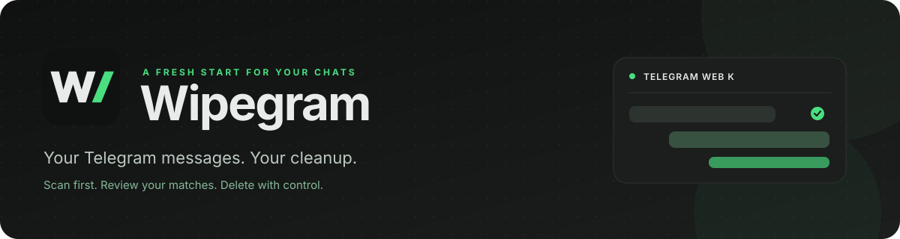
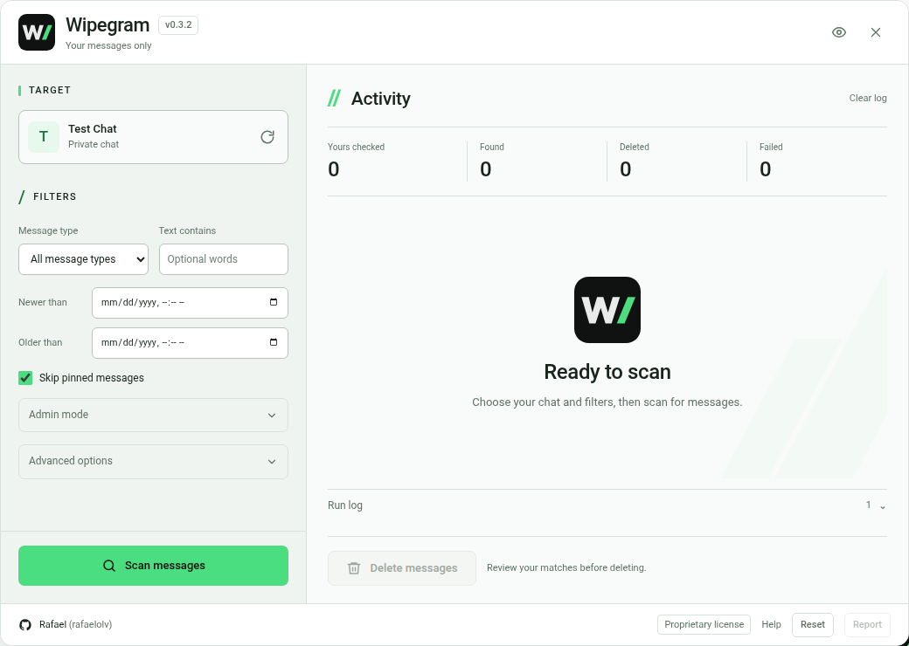
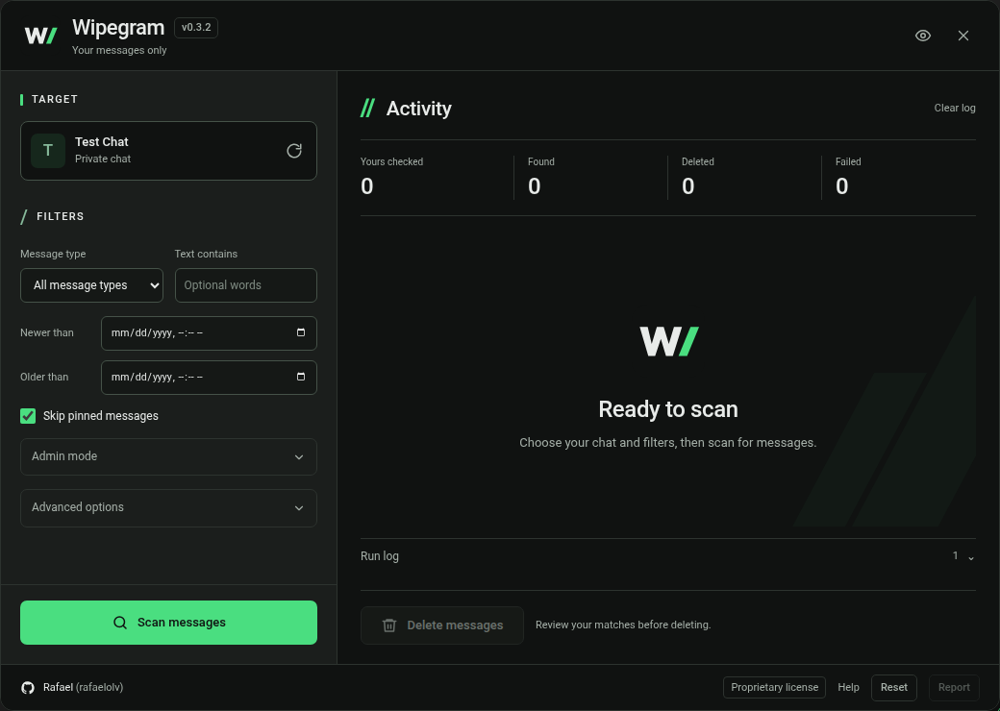

<p align="center">
  
</p>

<p align="center">
  <a href="https://github.com/rafelolv/Wipegram/releases/latest"></a>
  <a href="https://github.com/rafelolv/Wipegram/actions/workflows/ci.yml"></a>
  <a href="LICENSE"></a>
  <a href="https://web.telegram.org/k/"></a>
</p>

<p align="center">
  <strong>Clean up your own group history.</strong><br>
  Find, preview and bulk-delete your messages in Telegram Web K.<br>
  Pick your filters. Review the matches. Stay in control.
</p>

<p align="center">
  <a href="https://raw.githubusercontent.com/rafelolv/Wipegram/main/wipegram.user.js"></a>
  <a href="https://github.com/rafelolv/Wipegram/releases/download/v0.3.2/wipegram-chromium-0.3.2.zip"></a>
  <a href="https://github.com/rafelolv/Wipegram/releases/download/v0.3.2/wipegram-firefox-0.3.2.zip"></a>
</p>

<p align="center">
  <sub>Userscript recommended · Extension downloads: v0.3.2 · Local, unsigned packages</sub>
</p>

<p align="center">
  <a href="#install">Installation</a> &nbsp;·&nbsp;
  <a href="#quick-start">Quick start</a> &nbsp;·&nbsp;
  <a href="#features">Features</a> &nbsp;·&nbsp;
  <a href="docs/USER-GUIDE.md">User guide</a> &nbsp;·&nbsp;
  <a href="https://github.com/rafelolv/Wipegram/releases">All releases</a> &nbsp;·&nbsp;
  <a href="https://github.com/rafelolv/Wipegram/issues">Get help</a>
</p>

> [!WARNING]
> **Deleted means deleted.** Telegram cannot undo these deletions. Start with a small selection and review your matches before confirming.

## What Wipegram is for

Wipegram focuses on **your own messages in groups, supergroups, forum topics and channel discussion groups**. When a cleanup would require repeatedly finding and selecting batches of messages with Telegram's native tools, Wipegram scans your history, applies filters and lets you review the matches before deleting.

| Where | When Wipegram helps |
| --- | --- |
| **Groups, supergroups and forum topics** | Clean up your own message history while keeping other people's messages intact. |
| **Channel discussions** | Remove comments you posted as yourself in the channel's linked discussion group. Broadcast posts require explicit admin mode and verified deletion permission. |
| **Private conversations** | Delete a filtered selection of your own messages while keeping the rest of the conversation. |

For a complete cleanup of a private conversation, Telegram already lets you **clear the entire history for both people**. Choose the option to delete for both sides in Telegram; you do not need Wipegram for that. See [Telegram's deletion policy](https://telegram.org/privacy#10-deleting-data).

> [!TIP]
> Need to clean up Discord too? **[Also check WIPECORD](https://github.com/rafelolv/Wipecord)** — delete your own messages in Discord DMs, group chats and servers.

## Install

### Choose your way in

| 🟢 Userscript · recommended | 🔵 Chrome, Brave & Edge | 🟠 Firefox |
| --- | --- | --- |
| Install through **Tampermonkey** or **Violentmonkey**. | Download the **Chromium ZIP** above. | Download the **Firefox ZIP** above. |
| Easiest setup for most users. | Extract it, then use **Load unpacked**. | Extract it, then use **Load Temporary Add-on**. |
| Runs while Telegram Web K is open. | Chromium **111+** · manual updates. | Firefox **142+** · removed on browser restart. |

### Ready in four steps

1. **Get a userscript manager:** [Tampermonkey](https://www.tampermonkey.net/) or [Violentmonkey](https://violentmonkey.github.io/).
2. **[Install Wipegram](https://raw.githubusercontent.com/rafelolv/Wipegram/main/wipegram.user.js)** and accept the installation in your manager. If the link opens plain text, use your manager's new-script editor and paste the file there.
3. **[Open Telegram Web K](https://web.telegram.org/k/)**, log in and open a chat. Reload the page if Telegram was already open.
4. **Click W** in the chat toolbar, or press <kbd>Alt</kbd> + <kbd>Shift</kbd> + <kbd>W</kbd>. A second floating Wipegram button stays available above the message composer.

> [!TIP]
> **Already using the extension ZIP?** Follow the [browser extension guide](docs/EXTENSION.md) for installation and manual updates. Firefox ZIPs are unsigned; permanent installation in standard Firefox requires Mozilla signing.

Use **one Wipegram installation** and keep **one cleanup running** at a time. Telegram **Web A is unsupported**; it only displays a notice. The userscript install link follows `main`; [release attachments](https://github.com/rafelolv/Wipegram/releases/latest) are fixed snapshots.

<details>
<summary><strong>🛠 Prefer building from source?</strong></summary>

```bash
npm ci
npm run build             # userscript
npm run build:extensions  # userscript + both extension ZIPs
```

Install the generated `wipegram.user.js`, or load a package from `dist/chromium` or `dist/firefox`. Rebuild after editing sources. See [development](#development) for checks and source layout.

</details>

## A peek inside

| ☀️ Light mode | 🌙 Dark mode |
| :---: | :---: |
|  |  |
| Pick your target and filters. | Review your matches before deleting. |

## Features

| | Made for your cleanup |
| --- | --- |
| 🔎 **Find what matters** | Text, regex, dates, media types and forum-topic filters. Auto supplements sender search with one recent history page. |
| 👀 **Preview first** | Scan before deleting. Inspect matched messages, counts and the activity log. |
| 🛡️ **Keep control** | Own-message checks, pinned-message protection, account isolation and explicit confirmation. Type `DELETE` above 100 matches. |
| ⏳ **Respect the pace** | Batches of up to 100 IDs, bounded retries and automatic Telegram flood-wait handling. Stop with partial statistics. |
| 🫥 **Keep it private** | Blur names and previews with privacy mode. Export a local JSON report when needed. Reports contain private data. |
| ✨ **Make yourself comfortable** | Light/dark themes, mobile layout, keyboard access and the same engine in every distribution. |

**No bot token. No telemetry. No remote logging.** Wipegram uses the Telegram Web K session already open in your tab. It is an independent project, inspired by [Wipecord](https://github.com/rafelolv/Wipecord).

## Quick start

1. Open the chat, group, forum topic, or Saved Messages view you want to clean.
2. Click the **W** button in the topbar.
3. Choose filters (message type, text, regex, dates, pin handling).
4. Press **Scan messages**.
5. Review **Found messages**, the counts, and the activity log. Use **Report** if you want a JSON copy.
6. Press **Delete N messages**, review the confirmation, and confirm.
7. For more than 100 messages, type `DELETE` to enable the final button.
8. Press **Stop** if you change your mind. Messages already deleted cannot be restored.

## What is supported

| Target | Support |
| --- | --- |
| Private chats | ✅ |
| Basic groups | ✅ |
| Supergroups | ✅ |
| Forum topic (current topic) | ✅ |
| Forum (all topics) | ✅ |
| Saved Messages (main view) | ✅ |
| Saved sub-conversations | ❌ Blocked |
| Broadcast channels | Admin mode only: verified owner or delete-messages rights required |
| Direct messages to a channel (monoforum) | ❌ Blocked |
| Telegram Web A | ❌ Notice only |
| Secret chats | Not available in Web K |

Broadcast posts appear under the channel identity, including posts published by an administrator. Wipegram does not infer personal authorship from that identity: own-message mode blocks these posts. Explicit admin mode can include them when deletion permission is verified. Saved sub-conversations remain blocked because they require a different history scope. If a chat is not fully loaded yet, close and reopen it in Telegram, then try again.

### Message scope

**Your messages only is the default**, even if you are an administrator. The **Yours checked** counter counts unique own messages, and the preview contains only your matches. Auto checks one recent shared-history page after completed sender search; other authors are excluded from normal-mode candidates and counts.

To moderate a group or channel, expand **Admin mode** and explicitly enable **Include everyone's messages**. Wipegram requires verified owner/delete-messages permission, clears the previous preview and requires a new scan. Every admin deletion requires typing `DELETE` and explicit confirmation. The option is not saved and resets when the panel closes or the account/chat changes. Permission is checked before every admin request; losing it stops the operation.

## Filters

| Filter | Behavior |
| --- | --- |
| **Message type** | All, text, photos, videos, files, links, music, voice, or GIFs. Sender-search mode uses Telegram's server-side media filter; history mode classifies locally. |
| **Text contains** | Telegram search query in sender-search mode; local case-insensitive substring in history mode. |
| **Regex pattern** | JavaScript regular expression, case-insensitive, always checked locally. Example: `^hello\|invoice`. Invalid patterns are rejected before scanning. |
| **Newer than / Older than** | Local date and time bounds. Both ends are inclusive to the second. |
| **Skip pinned messages** | On by default. Pinned IDs are loaded before scanning. If they cannot be loaded, the scan aborts with `PINNED_UNAVAILABLE` rather than risk deleting a pinned message. |
| **Current topic only** | Visible in forum topics. When off, Wipegram scans the whole forum. |
| **Max messages** | Stops scanning after N matches. `0` or empty means unlimited. |
| **Scan method** | `Auto` (sender search, then one recent history page), `Telegram sender search`, or `Full history walk`. A message cap stops either Auto pass once reached. |
| **Pause between batches / pages** | Scan pages use at least 350 ms; set a longer pause if needed. Batch pauses remain optional. |

## How it works

<details>
<summary><strong>🔧 Telegram integration and API calls</strong></summary>

Wipegram talks to the Telegram Web K instance that is already open in your tab:

1. It reads the current chat from `window.appImManager.chat` and checks that the chat type is safe.
2. It reads the synchronous `window.apiManagerProxy.getPeer` mirror and builds an input peer using the loaded peer ID and access hash. Web K's worker-backed managers are asynchronous and cannot be used for synchronous target detection.
3. It scans with `messages.search` (sender = yourself) or `messages.getHistory` / `messages.getReplies`.
4. It filters the results locally for ownership, dates, pins, text, and regex.
5. It deletes with `messages.deleteMessages { revoke: true }` for private chats and basic groups, or `channels.deleteMessages` for supergroups and channels.
6. It waits and retries when Telegram returns flood or transient network errors.

No tokens or session strings are copied out of Telegram. The script runs in the page context and calls the same `apiManager.invokeApi` bridge that Telegram Web K uses itself.


</details>

## Safety model

Wipegram is deliberately conservative:

- **Only your own messages by default.** Other authors require explicit admin mode and verified group/channel deletion rights.
- **Delete for everyone where Telegram permits it.** For private chats and groups, `revoke: true` removes the message from both sides when Telegram allows it. For channels/supergroups, `channels.deleteMessages` revokes the messages.
- **Pinned messages are protected** by default. Pinned IDs are reloaded before deletion, and message-level pinned flags are also checked. Incomplete pagination or lookup failure stops the operation. Unchecking the option is the explicit opt-out. Pins added after the final check can still race with deletion.
- **Chat/account changes abort the operation.** Account identity is part of every preview key and is verified before every API call. A request already submitted can still finish after Stop or a chat change.
- **Chat previews and unsupported chats are blocked.** A chat preview is not the real conversation, and Saved sub-conversations are not supported yet.
- **More than 100 messages require typing `DELETE`.** Admin mode requires it for every deletion, regardless of size.
- **Long flood waits stop the operation.** Wipegram will not silently park your tab for more than 15 minutes.
- **No undo.** Telegram does not provide an undo for these deletions.

### Deletion limits per chat type

Telegram decides whether a message can be revoked. Depending on the chat type, message age, your role, and the message itself, Telegram may:

- delete the message for everyone,
- delete it only for you,
- refuse with `MESSAGE_DELETE_FORBIDDEN` or `CHAT_ADMIN_REQUIRED` (reported as skipped/failed),
- report that the message is already gone.

Wipegram retries a rejected batch one message at a time so a single problematic message does not block the rest, then reports exactly what happened.

## Rate limits and retries

<details>
<summary><strong>⏱ Batch sizes, flood waits and retry policies</strong></summary>

- Scan pages request at most 100 messages at a time.
- Delete requests contain at most 100 message IDs.
- `FLOOD_WAIT_X`, `FLOOD_PREMIUM_WAIT_X`, and `SLOWMODE_WAIT_X` are parsed and waited out automatically.
- Waits longer than **15 minutes** stop the operation with `FLOOD_TOO_LONG`.
- Up to **8 flood pauses per request** are tolerated; after that the operation stops rather than looping forever.
- Transient network/5xx errors are retried with exponential backoff (up to 3 attempts per request).

Telegram does not document a universal deletion requests-per-second quota. These batch sizes and retry caps are Wipegram policies, not guarantees against rate limits. The Bot API's deletion restrictions are not a specification for this logged-in user MTProto client. See [verified limits and technical sources](docs/TELEGRAM-LIMITS.md).

The activity log shows every wait and retry. The JSON report includes flood-wait counts and seconds.


</details>

## Report format

<details>
<summary><strong>📄 What the JSON report contains</strong></summary>

The **Report** button downloads a local JSON file containing:

- app version and export time,
- target title, kind, username, peer ID, Saved/channel flags, topic scope,
- active filters,
- scan and delete statistics,
- failed/skipped message IDs with error details,
- every matched message's ID, ISO date, media type, and preview.

The report can contain chat names and message previews. Treat it as private data. It is generated in your browser and never uploaded by Wipegram.


</details>

## Privacy

- No analytics, telemetry, or remote logging.
- No external network requests from the userscript.
- No bot token, API ID/hash, or session string is requested or stored.
- Privacy mode is persisted in `localStorage` as a single flag.
- The JSON report is created with a local Blob URL and downloaded directly.
- The script uses your existing Telegram Web K session only while the page is open.

## Troubleshooting

| Problem | What to try |
| --- | --- |
| No **W** button | Confirm the userscript is enabled, that you are on `/k/` (not `/a/`), then reload the page. A second floating Wipegram button is available while a chat is open. |
| “Chat unavailable” / “Telegram has not loaded this chat yet” | Close and reopen the chat, wait for messages to load, then press the refresh button in the panel. |
| “No messages matched these filters” | Broaden the date range, clear text/regex, choose a different message type, or switch to **Full history walk**. |
| “Pinned messages could not be loaded” | Leave the option on and reload the chat to try again. Only uncheck **Skip pinned messages** if you accept the risk. |
| “Telegram asked Wipegram to pause…” | Wait for the reported time, then retry. Telegram rate limits are shared by the whole account/session. |
| Some messages were skipped or failed | Telegram refused those messages, or they no longer exist. The activity log and JSON report show the reasons. |
| Panel is too tall on mobile | The panel body scrolls independently; close and reopen it if the Telegram layout changes. |
| Web A notice | Use Telegram Web K: <https://web.telegram.org/k/>. |

Telegram Web K is maintained by Telegram and its internals can change. If a scan suddenly fails after a Telegram update, check for a Wipegram update or open an issue with the activity-log errors.

## Development

<details>
<summary><strong>🧰 Setup, commands and source layout</strong></summary>

Requirements: Node.js 20 or newer.

```bash
npm ci
npm test          # unit tests (filters, errors, engine, Telegram adapter)
npm run build     # builds wipegram.user.js from src/
npm run build:extensions # same userscript bundled into Chromium/Firefox ZIPs
npm run test:ui   # Playwright UI smoke test (requires Chromium)
npm run test:extensions:browser # installed Chromium extension, simulated Telegram
npm run check     # tests + all builds + userscript/extension artifact validation
```

The UI test uses `playwright-core`. If Chromium is not in the default Playwright cache, set `WIPEGRAM_CHROME` to the browser executable:

```bash
WIPEGRAM_CHROME=/path/to/chrome npm run test:ui
```

Set `WIPEGRAM_UI_SCREENSHOT=0` to skip screenshots. The test writes them to `$TMPDIR/wipegram-ui-test.png` and `$TMPDIR/wipegram-ui-test-night.png`.

### Source layout

| Path | Purpose |
| --- | --- |
| `src/index.js` | Entry point, Web K/Web A routing, boot and debug handle |
| `src/telegram.js` | Web K adapter, target detection, MTProto calls |
| `src/engine.js` | Scan/delete orchestration, batching, retries, flood handling |
| `src/filters.js` | Filter normalization, media classification, local matching |
| `src/errors.js` | Error codes, classification, readable messages |
| `src/ui.js` | Panel, confirmation flow, progress, report |
| `src/panel.html`, `src/notice.html`, `src/dom.js` | Trusted templates compiled into DOM descriptors; no runtime HTML parsing |
| `src/styles.css` | Panel styling, themes, responsive layout |
| `src/launcher.js` | Topbar button, second floating button, shortcut |
| `src/unsupported.js` | Web A notice |
| `src/extension/` | Read-only extension popup |
| `build/extensions.mjs` | Manifest V3 packages, deterministic ZIPs and SHA-256 checksums |
| `build/templates.mjs` | Build-time HTML parsing with parse5; no parser shipped in the runtime |
| `test/` | Unit tests and Playwright UI test |
| `scripts/check-artifact.mjs` | Validates the built userscript metadata and bundle |
| `scripts/check-extensions.mjs` | Validates manifests, runtime parity, ZIP contents and checksums |

`window.__wipegram` exposes the UI, engine, adapter, and a `destroy()` method for debugging in the browser console.

</details>

## License and creator

Created by **Rafael (rafaelolv)**. Starting with **0.2.2**, original Wipegram material is distributed under a [proprietary personal-use license](LICENSE). Use official, unmodified packages for personal, non-commercial cleanups. Modification, redistribution, commercial use and derivative software require prior written permission.

Earlier MIT distributions, including v0.2.1, retain their original permissions. [Licensing details](docs/LICENSING.md).

## Contributing

Read [contributor guidance](CONTRIBUTING.md), [agent rules](AGENTS.md), [maintenance](docs/MAINTENANCE.md) and [release preparation](docs/RELEASING.md). CI checks tests and generated artifacts; pushing a release tag publishes validated downloads. Versioning keeps Wipegram's existing `0.x` history.

Bug reports are welcome. Code changes to covered proprietary material require prior written permission from the creator; see [contributor guidance](CONTRIBUTING.md). Please include:

- Telegram Web K version or the date you tested,
- chat type (private, group, supergroup, forum topic, Saved Messages),
- the exact error text/code from the activity log,
- screenshots with private data removed.

Do not paste session tokens, phone numbers, or private chat contents into issues.

---

<p align="center">
  <strong>Less clutter. More breathing room.</strong><br>
  <a href="https://raw.githubusercontent.com/rafelolv/Wipegram/main/wipegram.user.js">Install Wipegram</a> ·
  <a href="https://github.com/rafelolv/Wipegram/releases/latest">Downloads</a> ·
  <a href="CHANGELOG.md">Changelog</a> ·
  <a href="LICENSE">Proprietary license</a>
</p>

<p align="center">
  <sub>Created by <a href="https://github.com/rafelolv">Rafael (rafaelolv)</a>. Telegram is a trademark of Telegram Messenger LLP.<br>Wipegram is independent and is not endorsed by or affiliated with Telegram.</sub>
</p>
